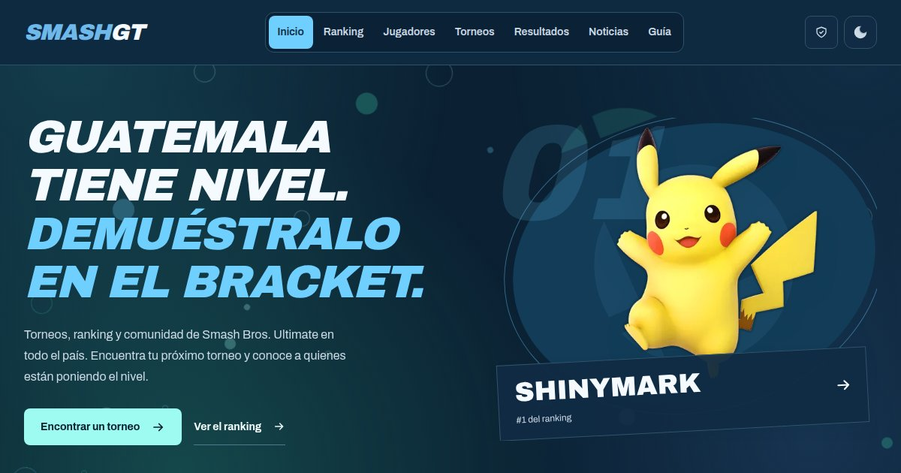
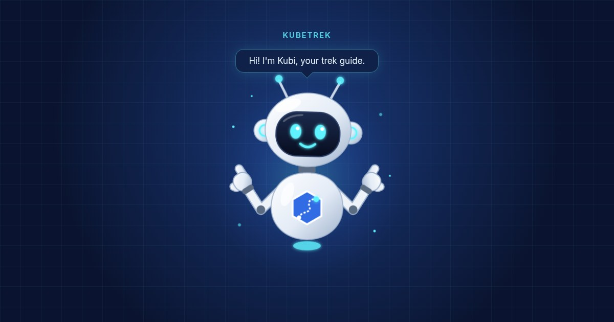

  

## `~/proyectos`

<table>
  <tr>
    <td width="50%" valign="top">
      
      <h3><a href="https://github.com/jordonez-usac/SmashGT">SmashGT</a></h3>
      
La escena competitiva de Super Smash Bros. Ultimate en Guatemala, en un solo sitio: ranking nacional, perfiles de jugadores, historial cara a cara, mapa de torneos por departamento, resultados, noticias y una guía para quien va a su primer torneo. Tiene un panel de administración para que los organizadores lo mantengan al día.

      
<code>React</code> <code>Vite</code> <code>Tailwind CSS</code> <code>Express</code> <code>MongoDB</code> <code>JWT</code> <code>Cloudflare Pages</code> <code>Render</code>

      
<a href="https://smashgt.pages.dev">Ver el sitio</a> · <a href="https://github.com/jordonez-usac/SmashGT">Código</a>

    </td>
    <td width="50%" valign="top">
      
      <h3><a href="https://github.com/kubetrek/kubetrek">KubeTrek</a></h3>
      
Una plataforma para aprender Kubernetes con un clúster real en tu máquina. La CLI <code>ktrek</code> levanta un clúster con kind, vigila lo que haces con <code>kubectl</code> y lo transmite a la web, que muestra en vivo cómo aparecen y mueren Deployments, Pods y Services. Cada paso se verifica solo, y Kubi te acompaña con pistas.

      
<code>Go</code> <code>client-go</code> <code>kind</code> <code>Cobra</code> <code>WebSocket</code> <code>Kubernetes</code>

      
<a href="https://github.com/kubetrek/kubetrek">Código</a> · en desarrollo

    </td>
  </tr>
</table>

## `~/stack`

  

